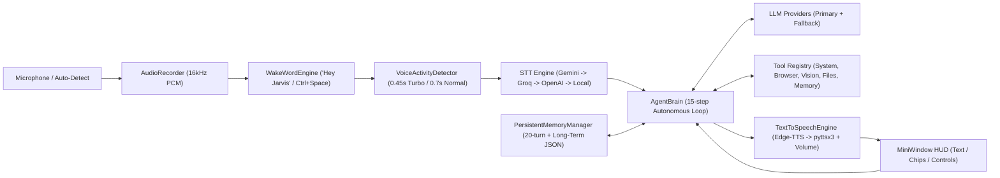

# VAX Voice Assistant — Full Code Audit, UI/UX Blueprint & Status Report

> **Last Audited:** 2026-11-25  
> **Project Root:** `d:\CD\AI Video\vax`  
> **Runtime Stack:** Python 3.14 · PySide6 · OpenWakeWord · Gemini / Groq / OpenAI / Anthropic / Ollama · Edge-TTS / pyttsx3 · Playwright

---

## 1. Executive Summary

A full-codebase audit was conducted across the voice pipeline, LLM agent brain, browser automation, configuration system, and PySide6 HUD. Several runtime crash bugs, UI hangs, microphone priority issues, and missing controls were identified and resolved.

In addition, the HUD (`vax/ui/mini_window.py`) was upgraded with a **Microphone Mute/Unmute Toggle** (auto-enabled by default on launch), a **Live TTS Volume Slider**, a **Memory Facts Inspector**, a **Normal/Turbo Mode Switcher**, and a resizable corner grip.

---

## 2. Issues Found & Fixes Applied

| # | Severity | Component / File | Problem Found | Resolution Applied |
|---|----------|------------------|---------------|--------------------|
| 1 | **Critical** | `vax/ui/tray.py` | `main.py` called `tray_mgr.set_listening_status(...)`, which did not exist on `TrayIconManager` (only `update_listening_status` existed) → `AttributeError` crash on mute toggle. | Added `set_listening_status(is_active: bool)` delegating to `update_listening_status()`. |
| 2 | **Critical** | `vax/voice/stt.py` | Missing `import time` caused `NameError` during 503 retry backoff. Also Gemini AFC overhead slowed STT. | Added `import time`, disabled AFC in `GenerateContentConfig`, added fallback chain (`Gemini → Groq → OpenAI → Local`). |
| 3 | **Critical** | `vax/voice/tts.py` | Non-reentrant lock deadlock left the UI stuck permanently in `SPEAKING` state. No volume control existed. | Replaced with `threading.RLock()`, added `_generation_id` guard, 15s `asyncio.wait_for` timeout, guaranteed `on_complete()` in `finally`, and added `set_volume(0.0–1.0)`. |
| 4 | **High** | `vax/main.py` & `vax/ui/mini_window.py` | Tray pause toggle (`_voice_muted`) and UI had no synchronized mic mute/unmute toggle; mic couldn't be silenced cleanly in UI, and muted state at launch wasn't respected. | Added `btn_mic_mute` (`🎙️` ↔ `🔇`) in `MiniWindow` header, saved `voice.mic_muted` (default `False` = auto-ON), unified Tray toggle with `mini_win.set_mic_muted()`, and blocked wake/PTT triggers when muted. |
| 5 | **High** | `vax/voice/recorder.py` | Windows default input check ran before filtering virtual/mapper devices (`AudioRelay`, `DroidCam`, `MIDI`), causing virtual mics to be selected over real headset/laptop mics. | Updated `start()` candidate prioritization so physical microphones always rank ahead of virtual/mapper devices unless explicitly chosen by user. |
| 6 | **High** | `vax/tools/browser.py` & `vax/tools/system.py` | `open_app("chrome")` failed because `chrome.exe` wasn't on Windows `PATH`. CDP fallback spawned repeated blank `New Tab` pages when port `9222` wasn't open. | Added explicit Chrome install path lookup, `_is_chrome_running()` detection, `_open_in_existing_chrome()` fallback, async CDP check via `httpx.AsyncClient`, and direct YouTube `watch?v=` URL scraping. |
| 7 | **Medium** | `vax/ui/mini_window.py` | `_show_memory_facts()` injected raw `<b>` tags before `append_transcript()` ran `html.escape()`, rendering literal HTML tags as plain text. | Updated `_show_memory_facts()` to pass clean formatted text to the styled `Memory` transcript card. |
| 8 | **Medium** | `vax/main.py` | Changing Turbo Mode in `SettingsDialog` did not update the `MiniWindow` pill button or `VAD.silence_threshold_sec` until app restart. | Updated `on_settings_saved()` to call `mini_win.sync_turbo_ui()` and update `vad.silence_threshold_sec` dynamically. |
| 9 | **Medium** | `vax/ui/settings/settings_dialog.py` | Network calls (`Fetch Models`, `Test Connection`) ran synchronously on the Qt main thread, freezing the Settings window. | Offloaded network calls to `_BackgroundWorker(QThread)` and added `chk_turbo` + `auto`/`gemini` STT options. |
| 10 | **Low** | `vax/agent.py` | Unused dead `ConversationMemory` class remained after switching to `PersistentMemoryManager` (`clear()` vs `clear_history()`). | Removed dead `ConversationMemory` class; `AgentBrain.memory` uses `memory_manager` consistently. |
| 11 | **Low** | `vax/config.py` | `DEFAULT_CONFIG["voice"]` lacked explicit defaults for `mic_muted` (`False`) and `volume` (`80`). | Added `"mic_muted": False` and `"volume": 80` to `DEFAULT_CONFIG["voice"]`. |

---

## 3. UI / UX Visual Design & Controls Blueprint

### 3.1 Floating HUD Layout (`vax/ui/mini_window.py`)

Window specifications:
- **Frameless translucent floating dark glassmorphic card** (`rgba(11, 16, 28, 245)`, `20px` border radius, `1px` cyan border glow, drop shadow `32px`).
- **Default Size:** `420 × 620 px` (positioned bottom-right, draggable anywhere, resizable down to `380 × 540 px` via bottom-right `QSizeGrip`).
- **Always-on-top** (`WindowStaysOnTopHint`) + **System Tray** background mode.

```text
┌───────────────────────────────────────────────────────────┐
│ 🤖 VAX AI   [READY]  [🛡️ NORMAL]    [🎙️][🧹][📋][⚙️][—]  │ ← 1. Header & Controls
├───────────────────────────────────────────────────────────┤
│ 🎙️ Mic Active: Headset (T-43)...       🔈 ───●─── 🔊     │ ← 2. Mic Status + Volume
├───────────────────────────────────────────────────────────┤
│                                                           │
│                    ╭───────────────╮                      │
│                    │  ╭─────────╮  │                      │
│                    │  │   ORB   │  │                      │ ← 3. Multi-Ring Voice Orb
│                    │  ╰─────────╯  │                      │    (30 FPS QPainter HUD)
│                    ╰───────────────╯                      │
│        Say 'hey jarvis', press Ctrl+Space, or click 🎙️   │ ← 4. Dynamic Status Hint
├───────────────────────────────────────────────────────────┤
│  [🎵 Song]   [🌤️ Weather]   [🖥️ PC]   [🌐 Chrome]  [🧠]   │ ← 5. Quick Chips + Memory
├───────────────────────────────────────────────────────────┤
│ ┌───────────────────────────────────────────────────────┐ │
│ │ ▎ You: Chrome open koro                               │ │
│ │                                                       │ │
│ │ ▎ 🤖 VAX: Chrome khulechi!                            │ │ ← 6. Color-Coded Card
│ │                                                       │ │    Transcript (HTML Cards)
│ │ ▎ ⚠️ Error: (If any error occurs, red callout card)   │ │
│ └───────────────────────────────────────────────────────┘ │
├───────────────────────────────────────────────────────────┤
│ [ Type command (Bangla / English)...     ] [🎙️] [➤] [STOP]│ ← 7. Input Dock & Actions
│                                                        ◢  │ ← Resize Grip
└───────────────────────────────────────────────────────────┘
```

### 3.2 Voice Orb Visual States (`VoiceOrbWidget`)

The central animated orb (`116 × 116 px`) rotates two counter-spinning segmented HUD arcs around a glowing radial core at 30 FPS:

| State | Primary Color | Badge Text | Animation Behavior | Trigger |
|-------|--------------|------------|--------------------|---------|
| `IDLE` | Cyan (`#38bdf8`) | `READY` | Calm breathing glow + slow ring rotation | Mic active, waiting for wake word or PTT |
| `LISTENING` | Emerald (`#10b981`) | `LISTENING` | Fast acoustic pulse + high-speed rings | Wake word (`Hey Jarvis`), `Ctrl+Space`, or `🎙️` clicked |
| `THINKING` | Amber (`#f59e0b`) | `THINKING` | Rapid dual-orbit spin | STT transcription or LLM / tool execution |
| `SPEAKING` | Violet (`#a855f7`) | `SPEAKING` | Harmonic wave amplitude glow | TTS vocalizing response |
| `NO_MIC` | Red (`#ef4444`) | `TEXT ONLY` | Minimal standby pulse | No microphone found / driver denied |
| `MUTED` | Slate (`#64748b`) | `MUTED` | Static dim core with red `×` cross-out | User clicked `🔇` Mic Mute toggle or Tray Pause |

### 3.3 All Interactive Controls

1. **Header Bar Controls:**
   - **Mode Pill (`🛡️ NORMAL` ↔ `⚡ TURBO`):** Toggles between Normal mode (0.7s VAD pause, balanced responses) and Turbo mode (0.45s VAD pause, ultra-fast 1-sentence replies).
   - **Mic Toggle (`🎙️` ↔ `🔇`):** Immediately stops/starts `AudioRecorder`, pauses/resumes `WakeWordEngine`, updates the System Tray menu, and persists `voice.mic_muted` (default: `False` → auto-ON at launch).
   - **Clear (`🧹`):** Clears transcript window and resets short-term rolling chat history (preserves long-term memory facts).
   - **Action Logs (`📋`):** Opens `LogViewerDialog` showing searchable tool audit logs (`Time`, `Tool`, `Risk`, `Status`, `Arguments`, `Result`).
   - **Settings (`⚙️`):** Opens 5-tab `SettingsDialog` (General, AI Provider + Fallback, Voice & Audio, Safety, Plugins).
   - **Minimize (`—`):** Hides floating HUD to System Tray (`Ctrl+Space` or tray click restores/triggers).

2. **Mic & Volume Strip:**
   - **Live Mic Pill:** Displays active device name (`🎙️ Mic Active: ...`) in green, `🔇 Microphone Muted` in slate, or exact driver error in red.
   - **TTS Volume Slider (`🔈 ───●─── 🔊`):** Adjusts spoken reply volume `0–100%` in real time and saves to `voice.volume`.

3. **Quick Action Bar:**
   - `🎵 Song` — Plays a Bangla song directly via YouTube resolution.
   - `🌤️ Weather` — Checks today's weather.
   - `🖥️ PC` — Reports CPU, RAM, disk, and battery via `get_system_health()`.
   - `🌐 Chrome` — Launches Google Chrome safely via direct executable lookup.
   - `🧠 Memory` — Displays all saved long-term user facts inside a purple Memory card.

4. **Bottom Input Dock:**
   - **Command Input:** Supports Bangla (`বাংলা`), Banglish, and English (`Enter` to send).
   - **Push-to-Talk (`🎙️`):** Triggers listening immediately (also retries auto-detecting mic if previously disconnected; blocked cleanly if muted).
   - **Send (`➤`):** Submits text command.
   - **Emergency Stop (`STOP` / `Ctrl+Alt+Esc`):** Immediately cancels running agent steps, stops TTS playback, and resets to Idle.

---

## 4. Microphone Auto-Detection & Mute Behavior

- **Default Behavior on Startup:** `voice.mic_muted` defaults to `False`. On launch, `AudioRecorder.start()` automatically scans available input devices and activates the best microphone in this priority order:
  1. Explicitly saved `voice.mic_device_index` (if configured in Settings)
  2. Windows default input device (only if it is a physical hardware mic)
  3. Physical hardware microphones (headsets, built-in arrays)
  4. Virtual/mapper fallbacks (`AudioRelay`, `DroidCam`, `Sound Mapper`)
- **Sample-Rate Adaptation:** Automatically opens at `16000 Hz`, or falls back to the hardware native rate (`44100`/`48000 Hz`) and linearly resamples to `16kHz` PCM16 for `openWakeWord` and `VAD`.
- **When No Mic Is Connected:** App does **not** crash — HUD switches to `NO_MIC` (`TEXT ONLY`), displays a clear Bangla/English error card, and keeps text input + quick chips fully usable. Clicking `🎙️` later re-attempts auto-detection.
- **When Muted (`🔇`):** Both `AudioRecorder` stream and `WakeWordEngine` pause immediately so zero audio is captured until unmuted (`🎙️`).

---

## 5. System Architecture



---

## 6. Feature & Capability Matrix

| Category | Capabilities / Tools | Status |
|----------|---------------------|--------|
| **Voice Activation** | Wake word (`hey jarvis`), Global PTT (`Ctrl+Space`), Local Qt shortcut, Emergency Stop (`Ctrl+Alt+Esc`), Mic Mute Toggle | ✅ Ready |
| **Speech Recognition (STT)** | Auto-fallback chain (`Gemini` → `Groq Whisper` → `OpenAI` → `Local faster-whisper`), Bangla + English + Banglish | ✅ Ready |
| **Speech Synthesis (TTS)** | `edge-tts` (`bn-BD-NabanitaNeural`) with `pyttsx3` offline fallback, interruptible playback, volume slider (`0–100%`) | ✅ Ready |
| **Memory** | Rolling 20-turn `chat_history.json` + persistent `long_term_memory.json` (`remember_user_info`, `recall_user_info`, `forget_user_info`) | ✅ Ready |
| **System & PC Control** | Open/close apps (with Chrome path fix), `get_system_health()` (CPU/RAM/Battery), volume/brightness, power actions (confirmation-gated) | ✅ Ready |
| **Browser & YouTube** | `play_youtube_video()` direct `watch?v=` lookup, `open_url()`, `search_google()`, CDP Playwright + existing-Chrome fallback | ✅ Ready |
| **Safety Guardrails** | `DANGEROUS` actions require explicit confirmation (`confirm`/`yes`/`ha`), Recycle Bin-only deletion, API keys stored in Windows Credential Locker | ✅ Ready |
| **UI / Settings** | Glassmorphic HUD, 5-tab Settings dialog (non-blocking worker threads), Searchable Audit Log Viewer, First-Run Wizard, System Tray | ✅ Ready |

---

## 7. Quick Verification & Run Commands

```powershell
# 1. Run automated unit test suite (from parent workspace root)
cd "d:\CD\AI Video"
python -m pytest vax/tests -v

# 2. Launch VAX Desktop Assistant (GUI Mode)
cd "d:\CD\AI Video\vax"
python main.py

# 3. Launch Text-Only Terminal Mode (CLI Mode)
cd "d:\CD\AI Video\vax"
python main.py --cli
```
